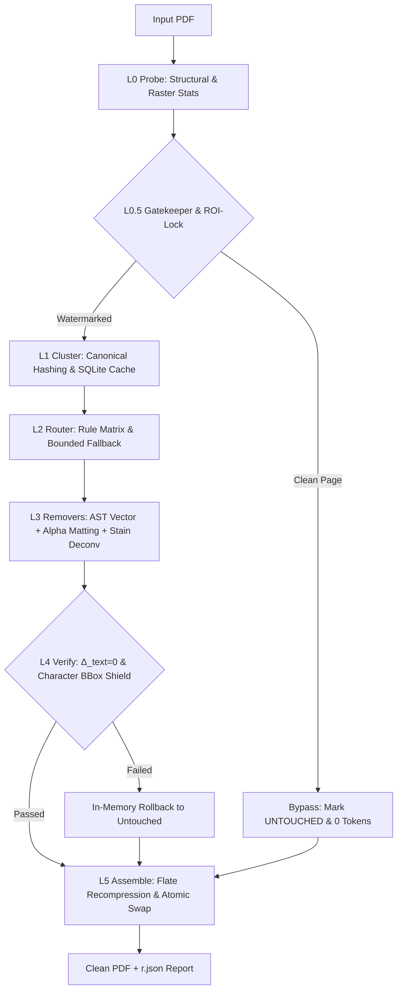

# watermark-remover-auto-agent-tool (`wmclean`)

[](https://github.com/Dev-Solanki-09/watermark-remover-auto-agent-tool/actions)
[](https://github.com/Dev-Solanki-09/watermark-remover-auto-agent-tool/releases/tag/v0.0.2-alpha)
[]()
[](LICENSE)
[]()
[]()
[](AGENTS.md)

**watermark-remover-auto-agent-tool** (`wmclean`) is a deterministic, high-throughput PDF forensic engine and watermark eradication CLI. It removes textual, vector, and raster watermarks using PDF content-stream AST manipulation, optical density separation, closed-form alpha matting, and mathematical verification gates.

It inspects input PDFs page-by-page, classifies watermark carriers (annotations, optional content groups, content stream text operators, XObjects, or raster background stamps), strips or unmixes them, verifies that body text and diagrams remain 100% intact ($\Delta_{\text{text}} = 0$), and writes a cleaned output PDF alongside a machine-readable JSON execution report.

---

## Key Features

- **Zero False Positives on Text ($\Delta_{\text{text}} = 0$)**: Strict L4 verification gates and glyph bounding-box protection ensure that body text, punctuation, diacritics, and mathematical formulas are never clipped, blurred, or lost. Any unresolvable conflict triggers an immediate rollback to `FLAGGED` or `UNTOUCHED`.
- **L0.5 Surgical Gatekeeper & ROI-Lock**: Fast pre-flight visual and structural heuristics immediately bypass untouched pages (`UNTOUCHED`), ensuring **0 LLM tokens** and **0 ms** wasted on clean content. Watermarks are isolated to sub-pixel coordinates; pixels and vector streams outside the ROI mask are mathematically locked and preserved.
- **Stage A AST Split-Kerning Reassembly**: Structural parsing on PDF content streams detects and reassembles obfuscated text arrays (`[(W) -15 (A) -15 (T)...]`), eliminating adversarial split-glyph watermarks without regex distortion.
- **SOTA Optical Density & Signal Processing**:
  - **Closed-Form Alpha Matting**: Solves Laplacian-guided alpha mattes to restore text beneath continuous, low-opacity diagonal stamps over complex or textured backgrounds.
  - **Stain Deconvolution**: Orthogonal color-matrix separation isolating colored reviewer stamps from monochrome underlying text.
  - **Sub-Pixel Chamfer Alignment**: Cross-page template correlation for repeated publisher stamps and watermark patches.
  - **Piracy & Ad OCR Spotter**: Targeted regex and heuristic scanning for Telegram stamps, URL watermarks, and mobile scanner branding.
- **CPU-Only & Memory Bounded**: Operates strictly on CPU using SIMD-accelerated NumPy and OpenCV with a hard **2.0 GB RAM cap**. Zero GPU or cloud runtime required.
- **Atomic & In-Place Safe**: Output PDFs and reports are written to temporary swap files (`<target>.tmp.<pid>`) and committed via atomic filesystem replacement (`os.replace`). In-place cleaning (`input.pdf -> input.pdf`) is safely supported.
- **LLM Agent Fast-Path**: Includes an [AGENTS.md](AGENTS.md) contract (<350 tokens) and programmatic stdout caps (≤300 tokens) allowing autonomous coding agents to orchestrate or modify watermark removal jobs with zero token bleed.

---

## Architecture Pipeline



---

## Installation

### Prerequisites
- Python 3.11 or newer
- Standard C runtime libraries (required by `pikepdf` and `OpenCV`)

### Install with `uv` (Recommended)
```bash
git clone https://github.com/Dev-Solanki-09/watermark-remover-auto-agent-tool.git
cd watermark-remover-auto-agent-tool
uv sync --all-extras
```

### Install with `pip`
```bash
git clone https://github.com/Dev-Solanki-09/watermark-remover-auto-agent-tool.git
cd watermark-remover-auto-agent-tool
pip install -e ".[dev]"
```

### Optional ML Fallback Dependencies
```bash
# Install with optional ONNX runtime for localized crop inpainting:
pip install -e ".[ml]"
```

### Self-Diagnostics
Verify your local environment and dependencies before processing files:
```bash
wmclean doctor
```
Expected output:
```
[PASS] Python 3.14.x (>= 3.10)
[PASS] Core dependencies (pikepdf, pymupdf, cv2, numpy, PIL, pydantic, sqlite3)
[PASS] Temp directory write permissions OK
[PASS] SQLite WAL journal mode supported
[PASS] System RAM check passed
```

---

## Quickstart & CLI Usage

### 1. Process a Single PDF
Clean a watermarked PDF and generate an execution report:
```bash
wmclean run document.pdf -o cleaned.pdf --report report.json
```

Stdout output (capped at ≤300 tokens):
```
WMCLEAN v0.0.2-alpha | document.pdf -> cleaned.pdf | status=OK (exit 0)
pages=12 | CLEAN_EXACT=10 | CLEAN_VERIFIED=2 | UNTOUCHED=0 | FLAGGED=0
size_in=1.4MB | size_out=1.2MB (0.86x) | time=2.1s | ram_peak=142MB | llm_calls=0
report=report.json
```

### 2. Batch Process a Directory
Process an entire folder of PDFs with checkpointing and resume support:
```bash
wmclean batch ./input_pdfs -o ./cleaned_pdfs --report batch_report.json --resume
```

### 3. Dry-Run Inspection & Planning
Probe PDF structure and preview planned removal rungs without modifying files:
```bash
wmclean plan document.pdf
```

### 4. Password-Protected Documents
```bash
wmclean run encrypted.pdf -o cleaned.pdf --password secret123
```

---

## CLI Exit Codes

`wmclean` emits deterministic exit codes for programmatic automation:

| Exit Code | Status | Meaning | Recommended Next Action |
|:---:|:---|:---|:---|
| `0` | **CLEAN** | All pages are `CLEAN_EXACT`, `CLEAN_VERIFIED`, or `UNTOUCHED`. | Output PDF is verified clean. Done. |
| `10` | **PARTIAL** | Watermarks removed, but ≥1 page is `FLAGGED` due to high occlusion risk. | Inspect flagged pages in `r.json` or stdout summary. |
| `20` | **UNSUPPORTED** | Encrypted PDF or unsupported XFA format. | Pass `--password <pw>` or notify user. |
| `30` | **CORRUPT** | Unrecoverable PDF syntax error. | Document is corrupted at the byte level. |
| `40` | **IO_ERROR** | File not found, permission denied, or disk space exhausted. | Check paths or free disk space; re-run with `--resume`. |
| `50` | **INTERNAL** | Verification engine invariant breach or unhandled internal error. | Check `r.json -> error_detail`. |

---

## Verification Gates & Quality Thresholds

`wmclean` prevents document damage by enforcing quantitative verification gates before accepting any page modification:

| Metric | Target | Description | Action on Breach |
|:---|:---:|:---|:---|
| $\Delta_{\text{text}}$ | **$0$** | Difference in non-watermark text characters | Immediate rollback; try next remover rung |
| $\Delta_{\bar{M}}$ | **$0$** | Difference in non-watermark vector path topology | Immediate rollback; try next remover rung |
| $L_{\text{fg}}$ | **$\le 0.020$** | Foreground content loss in raster channels | Immediate rollback; try next remover rung |
| $R_{\text{wm}}$ | **$\le 0.035$** | Residual watermark visibility in Lab color space | Trigger secondary unmixing or flag page |
| Size Ratio | **$\le 1.30\times$** | Output file size relative to input file size | Recompress stream or fail verification |

---

## Execution Report Contract (`r.json`)

When `--report <path>` is passed, `wmclean` atomically writes a structured JSON report matching the `DocumentReport` Pydantic v2 schema:

```json
{
  "v": "1.0",
  "in": "sample.pdf",
  "out": "sample_clean.pdf",
  "sha256_in": "d7a8fbb307d7809469ca9abcb0082e4f8d5651e46d3cdb762d02d0bf37c9e592",
  "sha256_out": "5e884898da28047151d0e56f8dc6292773603d0d6aabbdd62a11ef721d1542d8",
  "exit": 0,
  "counts": {
    "total": 3,
    "exact": 2,
    "verified": 1,
    "untouched": 0,
    "flagged": 0
  },
  "perf": {
    "ms": 1420,
    "peak_mb": 185,
    "llm_calls": 0,
    "llm_tok": 0,
    "size_ratio": 0.92
  },
  "clusters": [
    {
      "id": "c1",
      "sig": "3a8f10c7e2b1",
      "pages": "1-3",
      "chain": ["text_op_strip"],
      "src": "RULE"
    }
  ],
  "pages": [
    {
      "p": 1,
      "st": "CLEAN_EXACT",
      "m": ["text_op_strip"],
      "res": 0.0,
      "loss": 0.0,
      "ms": 412
    }
  ]
}
```

---

## Agent Fast-Path Contract

Autonomous orchestrator agents should use [AGENTS.md](AGENTS.md) as a direct operational reference. It provides:
1. Zero-code-exploration direct execution commands.
2. Single-file jump tables for targeted bug fixes.
3. Token-silent developer commands (`make check-q`, `make test-q`, `make smoke`).

---

## Developer Tooling & Verification

The root `Makefile` (and `make.bat` for Windows) provides token-efficient commands:

```bash
# Run Ruff linting and Mypy typechecking (0 tokens output on pass)
make check-q

# Run fast unit test suite (60 tests, quiet, failures only)
make test-q

# Run healthcheck diagnostics and end-to-end smoke test
make smoke
```

---

## Acknowledgements & Prior Art

`watermark-remover-auto-agent-tool` synthesizes, unifies, and builds upon pioneering open-source PDF watermark removal techniques:

- **[kanzure/pdfparanoia](https://github.com/kanzure/pdfparanoia)**: Pioneered split-kerning array (`TJ`) scrubbing and structural publisher watermark stripping using `pikepdf`.
- **[chazeon/PDF-Watermark-Remover](https://github.com/chazeon/pdf-watermark-remover)**: Inspired our L3 vector object-tree traversal and indirect `/XObject` dictionary deletion patterns.
- **[jamespan/pdf-unstamper](https://github.com/jamespan/pdf-unstamper)**: Pioneered keyword-based content-stream text operator matching across font encodings, informing our `text_op_strip` AST rewriter.
- **[jonatw/pdf-watermark-remover](https://github.com/jonatw/pdf-watermark-remover)**: Demonstrated content-stream token filtering and structural PDF object unlinking.
- **[Goshin/Remove-PDF-Watermark](https://github.com/Goshin/Remove-PDF-Watermark)**: Demonstrated template matching with normalized cross-correlation (`TM_CCOEFF_NORMED`) for raster watermark patch detection and erasure.
- **[LJSthu/Python-Remove-Watermark](https://github.com/LJSthu/Python-Remove-Watermark)**: Pioneered adaptive $\Delta E$ color thresholding and background luminance whitening for scanned PDF watermarks.
- **[watermark-remover-cli](https://pypi.org/project/watermark-remover-cli)**: Demonstrated HSV chroma and saturation separation for isolating colored overlays over dark text.
- **Foundational Engines**: Built upon the PDF primitives of [pikepdf](https://github.com/pikepdf/pikepdf) (QPDF core) and [PyMuPDF](https://github.com/pymupdf/PyMuPDF) (MuPDF core), alongside [OpenCV](https://opencv.org/) and [NumPy](https://numpy.org/).

---

## License

This project is licensed under the [MIT License](LICENSE).

